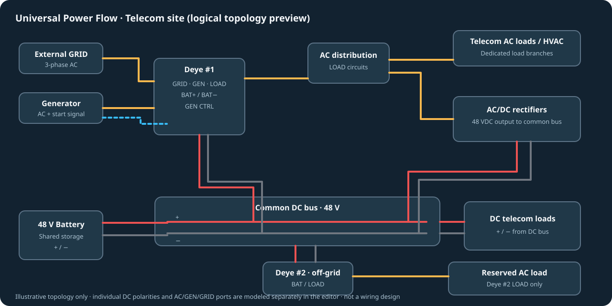

# Universal Power Flow Card

**Visual topology designer and animated electrical-power dashboard for Home Assistant.**



*Illustrative architecture preview; this is not a screenshot or a physical wiring diagram.*

Developed in [maksbit/universal-power-flow-card](https://github.com/maksbit/universal-power-flow-card), independently from the original Sunsynk Power Flow Card. The new Lovelace element is `custom:universal-power-flow-card`, and the JavaScript resource is `universal-power-flow-card.js`. Both cards can coexist on one Home Assistant dashboard.

## Getting started

A preview release will be published when the CI and Home Assistant checks pass. Add this repository as a HACS custom frontend repository, install the **Universal Power Flow Card** release and add it to a dashboard, selecting the visual editor.

To test an unreleased build, use the JS artifact produced by the **CI - typecheck, unit tests and build** workflow, save it to `/config/www/universal-power-flow-card/universal-power-flow-card.js`, add **JavaScript module** dashboard resource `/local/universal-power-flow-card/universal-power-flow-card.js`, then add:

```yaml
type: custom:universal-power-flow-card
title: Telecom power infrastructure
```

The card initially shows the **example topology** with no animated values; telemetry is not fabricated. Open the visual editor to bind each edge to its power sensor.

## Visual editor

**v0.1.3:** Obstacle-aware Manhattan pathfinding avoids component boxes with clearance, replans lines when devices move, and discourages overlapping wiring corridors. The editor now sends immutable configuration snapshots and triggers a dedicated reactive refresh on each edit, so deletions and parameter changes should immediately affect the canvas and Lovelace preview. If an automatic route is impossible, the editor reports it rather than silently drawing a line through equipment. Manual bend points and straight mode remain explicit user overrides and may cross equipment; inspect those links visually.


**v0.1.2 layout usability:** click **Full-screen editor** to work on a large responsive canvas, not in Home Assistant's narrow card setup column. Drag device bodies to move (window-level pointer tracking); select components/wires from the **Selected** list and click **Delete selected**, or select on the canvas and press Delete. Wires use automatically separated orthogonal lanes rather than a shared center; select a wire to configure routing axis, lane offset, color, width, speed and optional signed power sensor. Double-click a wire to add manual bend handles, or use **Edit bends**; drag handles and **Reset auto bends** to revert.


- Drag equipment from the palette onto the canvas or use **+ Add**.
- Move devices by dragging them; Shift+drag an empty background to pan; Ctrl+wheel or +/- buttons to zoom.
- Click the **source port**, then the **target port** to connect. AC, DC positive, DC negative, PV and control/signal cannot be mixed.
- Select a connection to bind a Home Assistant power entity (W/kW/MW), invert its sign, add or drag bend points, or use automatic orthogonal routing.
- Select equipment to edit its name, icon (`mdi:...`), size, scale, rotation, optional status/SOC entity, and electrical ports.
- Use **Save as component** to store customized equipment templates in this card's configuration.
- Export/import JSON to reuse layouts, including their custom library. Import validates topology.
- Configuration changes are persisted by Home Assistant's standard Lovelace `config-changed` editor event; edit via dashboard configuration mode. Export is recommended for backup.

## Electrical semantics

| Wire | Port kind | Appearance |
|---|---|---|
| AC | `ac` | amber |
| 48V DC positive | `dc+` | red |
| 48V DC negative | `dc-` | dark |
| Photovoltaic +/- | `pv+`, `pv-` | gold / gray |
| Generator start / signalling | `signal` | blue dashed |

A positive power-sensor reading animates **from source to target**, a negative reading reverses direction. Use **Invert flow direction** when a meter has the opposite sign convention. Zero/unknown/unavailable readings do not animate; **unknown is never silently interpreted as zero**. Circuit power must be measured independently: sums of common-bus, inverter and rectifier powers can double count recirculated energy.

Port compatibility checks are **diagramming safeguards**, not full electrical-design verification; they do not enforce voltage ratings, phases, earthing or protection coordination. The visual card does not control electrical equipment.

## Example: dual-Deye telecom site

The starter diagram illustrates external GRID → Deye #1 GRID; generator AC → Deye #1 GEN with a separate start signal; Deye #1 LOAD → AC distribution, AC loads and AC/DC rectifier; rectifier DC+/− → shared 48V bus; battery DC+/− and both Deye BAT+/− ports → **the same bus**; Deye #2 LOAD → separate off-grid AC load; telecom DC servers connected to the DC bus through DC+/− connections. The DC bus is **not an AC load**. Values stay unavailable until sensors are configured.

## Technology

TypeScript, Lit 3, SVG with SMIL animateMotion, Rollup, browser-native pointer events, structured JSON schema (version 1), Home Assistant Lovelace config-changed event. No backend service is required.

```sh
npm install --legacy-peer-deps
npm run typecheck
npm test
npm run build
```

## Licensing / upstream attribution

This repository derives from [slipx06/sunsynk-power-flow-card](https://github.com/slipx06/sunsynk-power-flow-card), originally authored by slipx06. The original MIT LICENSE and copyright notice are preserved. Independent universal-editor functionality is developed in this repository.
